# HSA Locker

Every medical receipt and EOB for your HSA, kept, read and totaled in one place. Forward receipts to your own dedicated email inbox or snap a photo, and HSA Locker keeps the original, reads it (text from PDFs, a vision model for photos and scans) and turns it into structured data you can rely on: date, patient, provider, amount and card. Anything it isn't sure about gets flagged for your review instead of slipping into your totals.

It works whether you reimburse yourself as you go or follow the shoebox method: pay out of pocket, let the HSA grow, and pull the money out tax-free years later, as long as you can still prove the expense. That proof is the whole point, and this is where it lives.

It's also MCP-enabled, so you can ask an AI assistant what's reimbursable, fix or approve entries, record a reimbursement, or dig into your spending on the fly.

[](https://deploy.workers.cloudflare.com/?url=https://github.com/tyler-class/HSA-Locker)

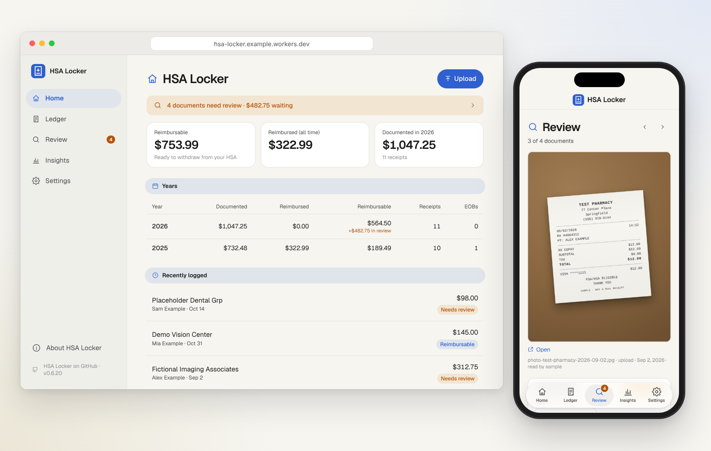

- **Every original, kept.** PDFs, photos and the emails they came in are stored privately in your own Cloudflare R2 bucket and open only through the app.
- **Read for you.** Each document is read by an AI model (Workers AI by default, inside your Cloudflare account) into dates, patient, provider, amount and card. Receipts become one entry; EOBs become one line per service.
- **Checked, not guessed.** An amount that isn’t printed in the document, a patient name that’s missing or close to someone you have but not quite (“Wm. Smith”), a likely duplicate or a date in the future goes to **Review** instead of into your totals.
- **What you can reimburse.** Home shows reimbursable, reimbursed and documented per year. EOB lines are kept for reference and never count as money. Receipts paid with your HSA card are marked not claimable automatically.
- **Record reimbursements.** Select receipts, record the withdrawal, and compare the total with your HSA statement. Undo any time.
- **Review reminders.** Optionally, a daily email when something is waiting in Review, sent by the Worker itself to an address you verify in Cloudflare.
- **Email inbox.** Give HSA Locker a private address on a subdomain you own and set your mail to forward receipts and EOBs to it. Gmail’s forwarding confirmation code shows up right in the app.
- **People and providers.** “Sam”, “Sam Example” and “Example, Sam” are one person; “Lakeside Surgical Suit” on an EOB can be the same provider as on the receipt. A new name on a receipt adds that person to **Settings → People** on its own.
- **Insights.** Charts that answer the usual HSA questions: how much you can reimburse and how it built up over time, spending by month, quarter or year, how old your unclaimed receipts are, and where the money goes by category, person and provider. Drag panels to arrange them, make them half or full width, or hide them.
- **Exports.** A CSV of the ledger (any filter), a JSON backup, and a ZIP of every original named by date, person, provider and amount: an audit packet.
- **AI assistants.** Connect Claude, ChatGPT or any MCP-capable assistant to ask what’s reimbursable or record a reimbursement.
- **Yours.** It runs on your own Cloudflare account. No third-party scripts. The only thing it sends out is an anonymous daily count you can switch off, and nothing from your receipts or documents is ever in it.

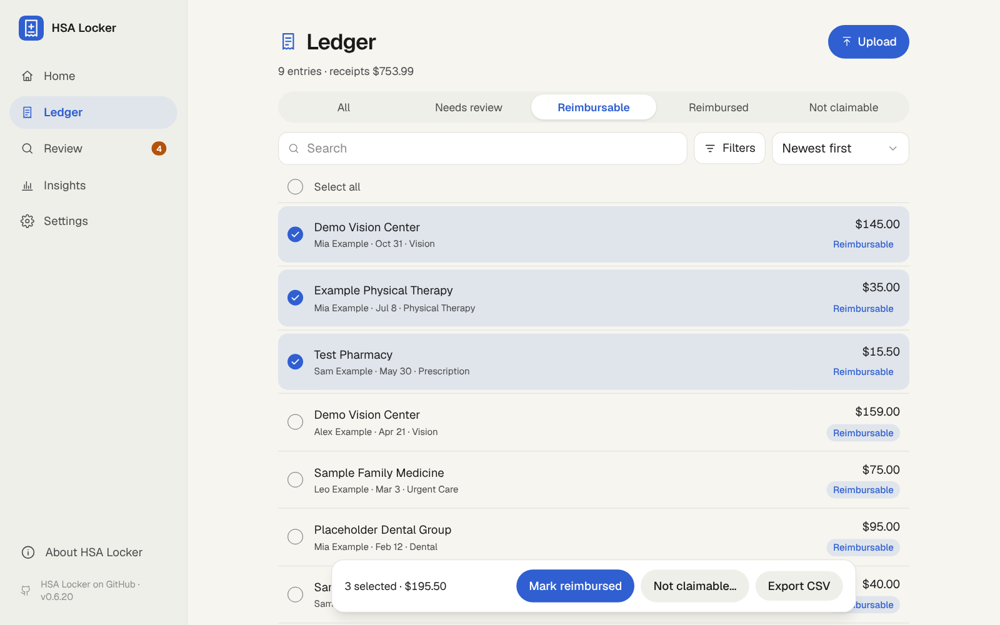

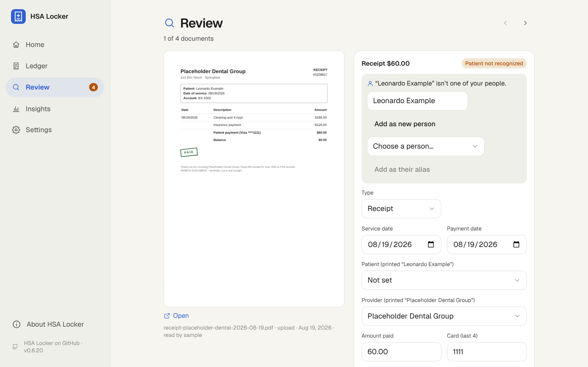

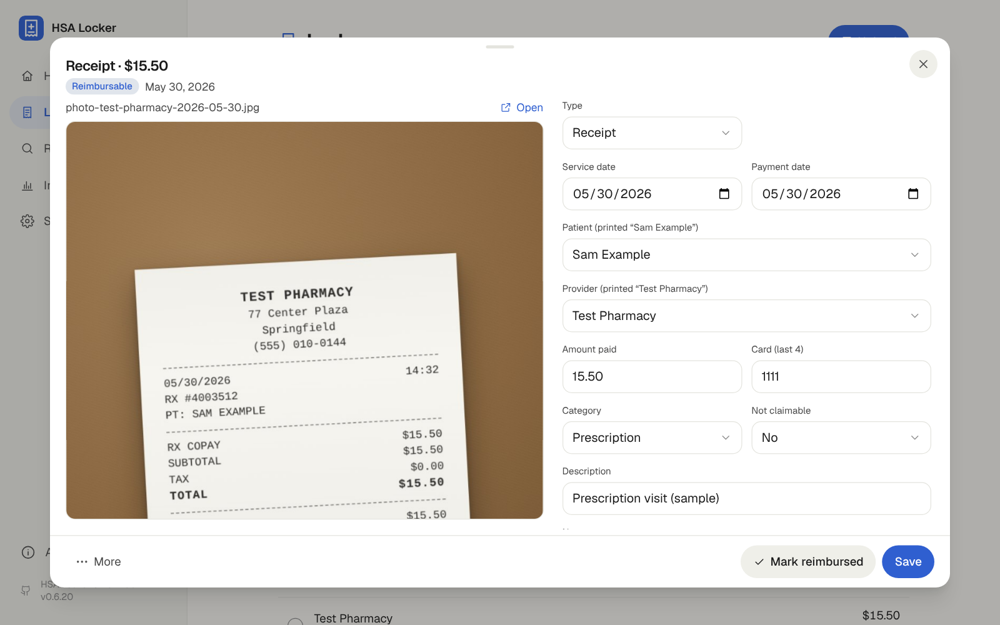

**Ask your assistant, typed or out loud.** It walks you through the Review queue, approves what you confirm, and tells you how much you can reimburse yourself.

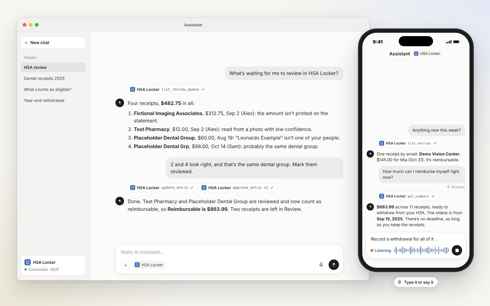

One deployment is one household. HSA Locker isn’t tax advice and makes no HIPAA compliance claims.

## A look around

**Ledger.** Every receipt and EOB line with its status; **Filters** narrows by year, type, person, category and provider; tap an entry to check or fix what was read.

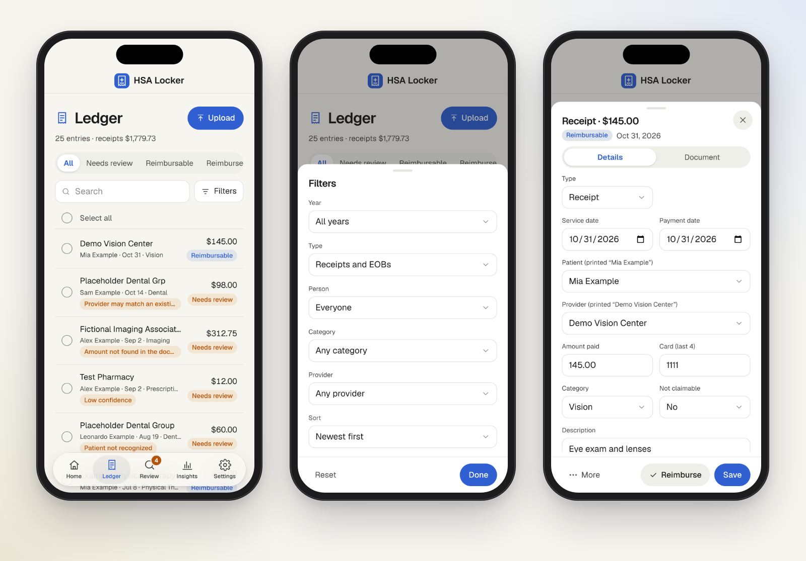

**Documents.** **Upload** takes PDFs and photos (**Take photo** on a phone). The original opens beside its entry and zooms with a pinch; one that came by email keeps the email it came in.

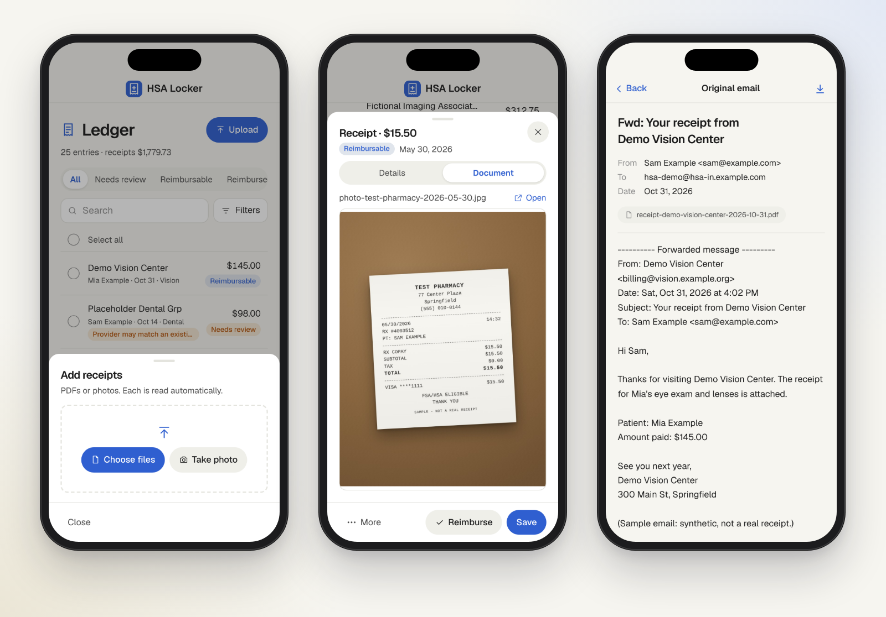

**Review.** Anything that needs a look waits here with the reason, like a provider name that's close to one you have.

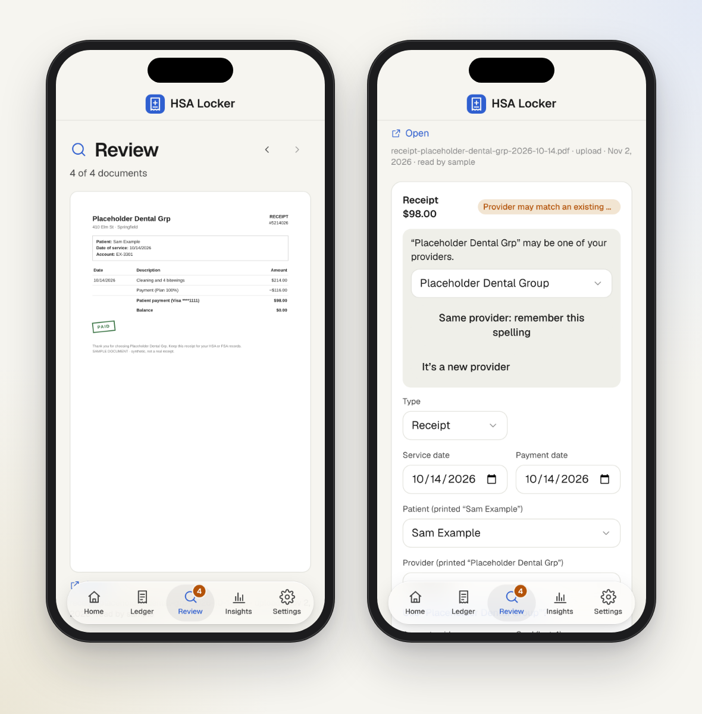

**Reimbursements.** Select receipts, record the withdrawal, and see each reimbursement's receipts later.

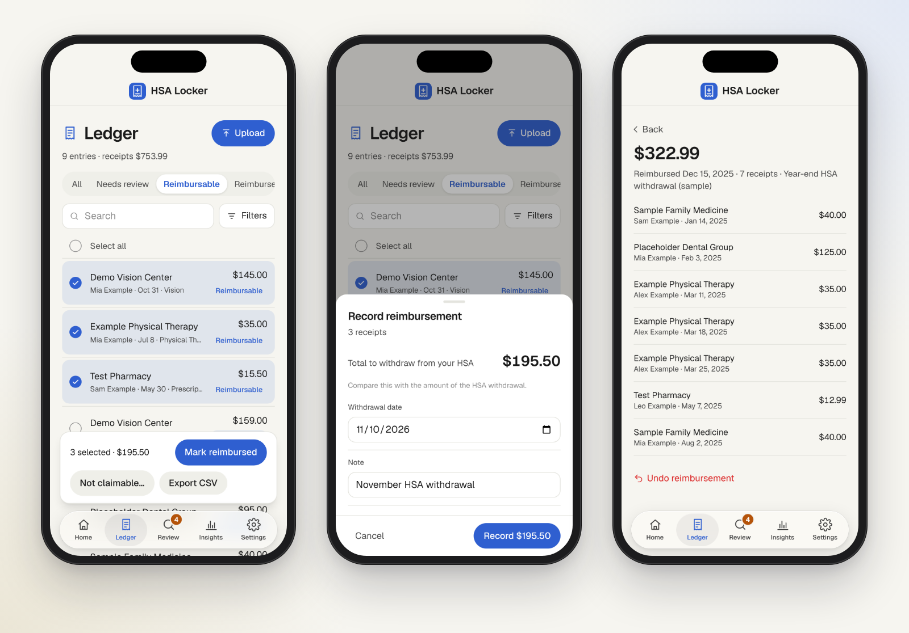

**Insights.** How much you can still reimburse and how it built up, spending by month, quarter or year, how old your unclaimed receipts are, and where the money goes by category, person and provider. Drag panels to arrange them, make them half or full width, or hide them.

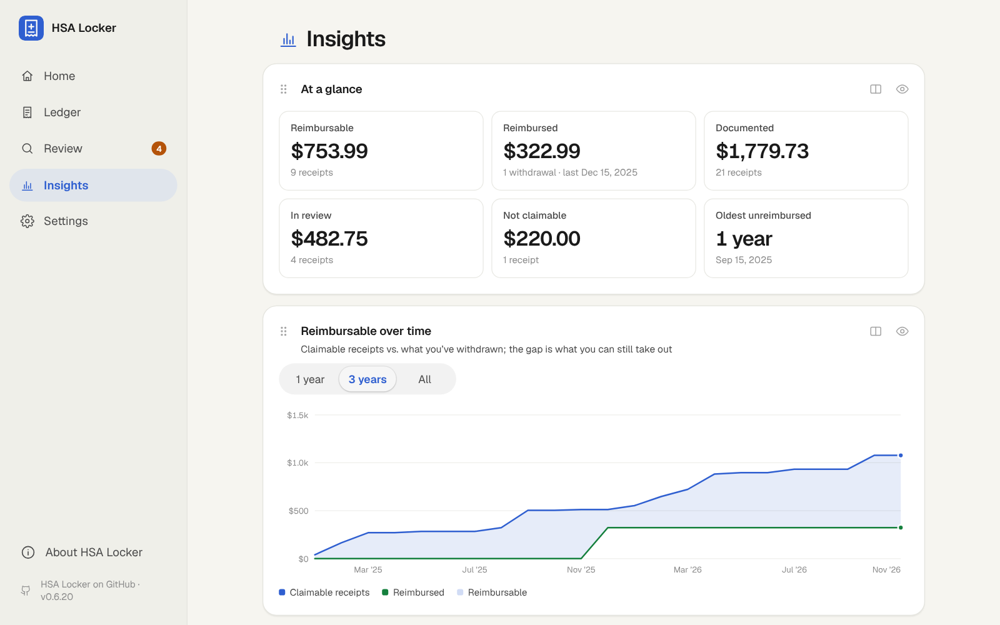

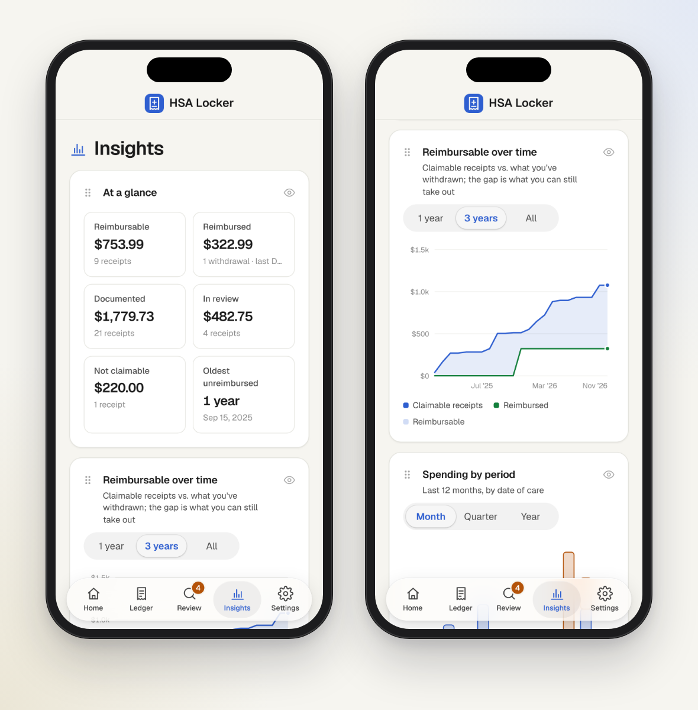

**Providers and categories.** Both fill in from your receipts. **Might be the same** asks whether a near-miss name is a provider you already have.

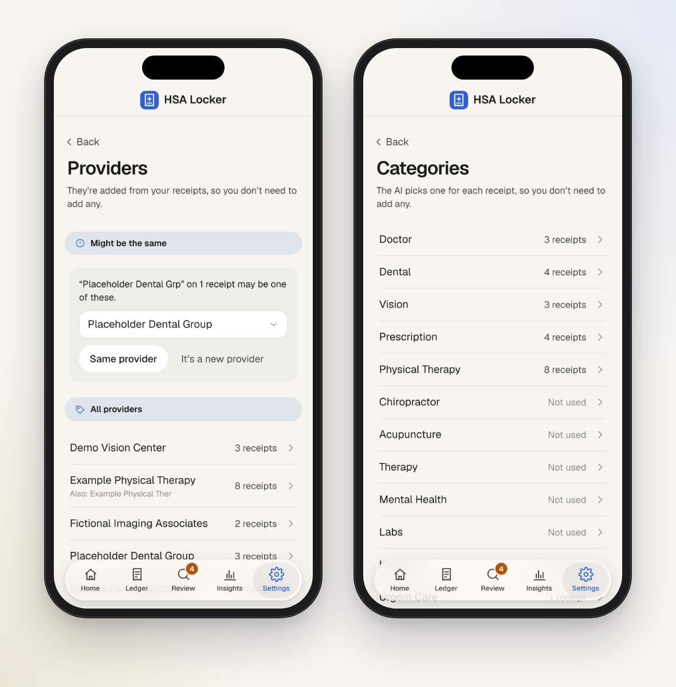

**People and HSA cards.** Spellings of a name match one person. Receipts paid with an HSA card you list are marked not claimable.

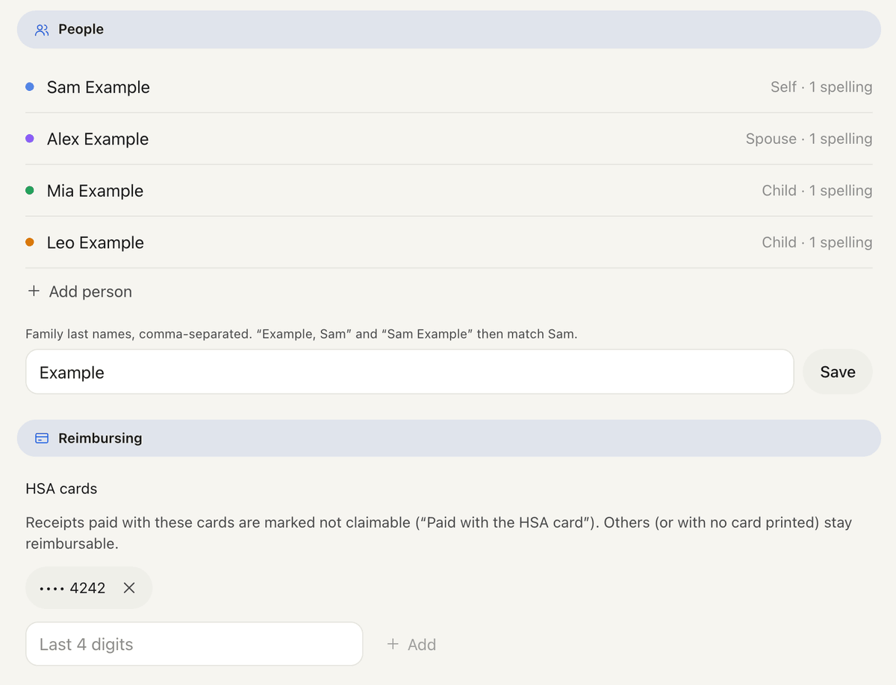

## Before you install

- **Enable R2 on your Cloudflare account.** File storage uses Cloudflare R2. Its free tier (10 GB) is plenty, but Cloudflare asks you to add R2 to your account (**Dashboard → R2**) with a payment method on file before a bucket can be created. Do that first, or the deploy can’t create the bucket.
- **Workers Paid ($5/month) is recommended if you’ll forward email or upload photos.** The free plan gives each request 10 ms of CPU. Reading text PDFs fits; parsing larger emails and preparing photos for the AI model often doesn’t. Uploading PDFs works on the free plan.

<!-- 📸 SCREENSHOT docs/screenshots/r2-enable.png: Cloudflare's R2 page with the button to add R2 to the account -->

<!-- kit:readme:start -->
<!-- Written by the Selfhost Kit (kit/docs/readme-install.md): edit it there. -->

## Install

You need two free accounts, and about five minutes.

### 1. Have a Cloudflare account

HSA Locker runs on your own Cloudflare account. The free plan is plenty. If you don't have one, [sign up](https://dash.cloudflare.com/sign-up) and confirm your email.

<!-- 📸 SCREENSHOT docs/screenshots/install-1-cloudflare-signup.png: Cloudflare's sign-up page -->

### 2. Have a GitHub account

The Deploy button makes your own copy of HSA Locker's code in your GitHub account, so you can keep it updated. If you don't have one, [sign up](https://github.com/signup).

### 3. Let Cloudflare use your GitHub

Cloudflare needs its **Cloudflare Workers and Pages** app installed on your GitHub account to create your copy and deploy it.

1. Open [github.com/apps/cloudflare-workers-and-pages](https://github.com/apps/cloudflare-workers-and-pages) and click **Install** (or **Configure** if it's already installed).
2. Choose your account.
3. Pick **All repositories**. That's simplest, because the Deploy button creates a new one. If you'd rather limit it, choose **Only select repositories** and come back to add your HSA Locker copy after step 4.
4. Click **Install**.

<!-- 📸 SCREENSHOT docs/screenshots/install-3-github-app.png: GitHub's install page for Cloudflare Workers and Pages, with All repositories selected -->

You can also do this in the middle of the next step: Cloudflare asks you to connect GitHub if you haven't.

### 4. Click Deploy

[](https://deploy.workers.cloudflare.com/?url=https://github.com/tyler-class/HSA-Locker)

Sign in to Cloudflare if it asks. You land on a setup page.

<!-- 📸 SCREENSHOT docs/screenshots/install-4-deploy-page.png: Cloudflare's "Create an application" page for HSA Locker -->

### 5. Check the names (most people keep the defaults)

- **Git account**: your GitHub account.
- **Repository name**: what your copy is called on GitHub. Leave **Create private Git repository** ticked to keep it private.
- **Project name**: the Worker's name, which is also in your address: `https://hsa-locker.<your-subdomain>.workers.dev`.
- **Database and storage names**: what Cloudflare calls the storage it creates for you. Keep them.

### 6. Set your password

Under **Variables and secrets**, fill in **APP_PASSWORD**: the one password everyone in your household uses to sign in. Pick something long. You can change it later (see [Change your password](#change-your-password)), but set it now.

<!-- 📸 SCREENSHOT docs/screenshots/install-6-password.png: The APP_PASSWORD field on the setup page -->

### 7. Create and deploy

Click **Create and deploy**. Cloudflare copies the code to your GitHub, creates the storage and builds HSA Locker. It takes a minute or two. When the build log finishes, your address is at the end of it, and on the Worker's page under **Domains**.

<!-- 📸 SCREENSHOT docs/screenshots/install-7-build-done.png: A finished build log with the workers.dev address at the end -->

Open it, sign in with your password, and you're done. Bookmark it, or add it to your phone's home screen.

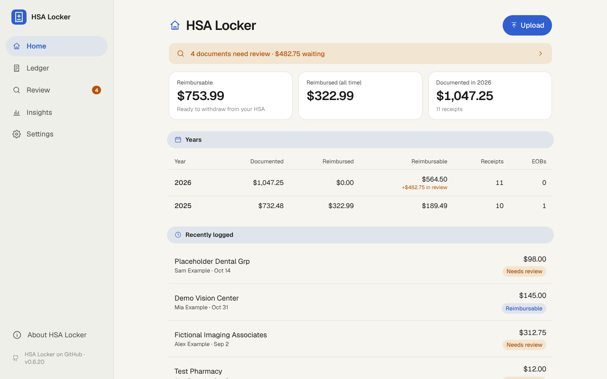

### 8. Set up automatic updates (recommended)

Your copy updates itself every Monday once you allow it. That takes one click, once:

1. In HSA Locker, open **Settings → Updates** and choose **Set up automatic updates**.
2. GitHub opens with the update file filled in. Click **Commit changes**.

That brings in the latest HSA Locker straight away, then every week. See [Updates](#updates) for how it works.

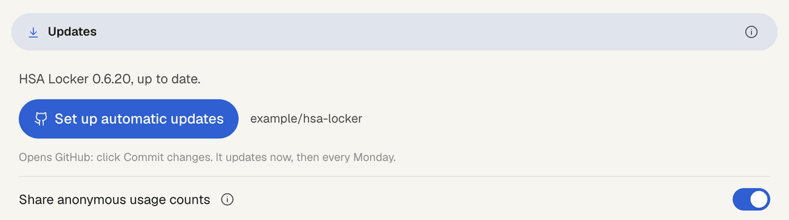
<!-- 📸 SCREENSHOT docs/screenshots/install-8-commit.png: GitHub's new-file page with the update file filled in, and the Commit changes button -->

## Notifications

HSA Locker can send notifications to your phone. They only work in the app installed on your phone (added to your Home Screen), not in a browser tab.

**Install it on iPhone or iPad** (iOS 16.4 or later):

1. Open HSA Locker in Safari and tap **Share**.
2. Tap **Add to Home Screen**, then **Add**.
3. Open HSA Locker from the new Home Screen icon.

**Install it on Android:** open HSA Locker in Chrome, open the menu **⋮** and tap **Install app** (or **Add to Home screen**), then open it from the new icon.

**Turn them on:** in the installed app, open **Settings → Notifications** and switch on **Notifications on this device**. Allow notifications when your phone asks. Each phone chooses its own, so everyone in the family can pick what they get. **Send a test** checks it's working.

## Updates

Updates take two steps, both in your own accounts. HSA Locker never deploys to your Cloudflare directly.

1. **HSA Locker → your GitHub copy.** The update workflow you added in step 8 brings in the latest code every Monday. To update now, open **Settings → Updates → Update now** and click **Run workflow** on GitHub. Settings also tells you when a newer version is out.
2. **Your GitHub copy → your Cloudflare.** Cloudflare builds and deploys every change to your copy, migrating the database first. This was switched on in step 7.

Your data lives in your Cloudflare database and file storage, not in the code, so updates don't touch it. An update replaces the code in your copy, so changes you made to it are overwritten. Your copy's own name and storage settings are kept.

Deployed by hand instead? `git pull`, then `npm run deploy`.

## Change your password

1. In Cloudflare, open **Compute → Workers & Pages** and choose **hsa-locker**.
2. Open the **Settings** tab. Under **Variables and Secrets**, find **APP_PASSWORD** (type **Secret**) and click its pencil icon.
3. Type the new password and save. You can't see the current one, only set a new one.

Everyone is signed out and signs in again with the new password.

<!-- 📸 SCREENSHOT docs/screenshots/password-1-secrets.png: The Variables and Secrets list with APP_PASSWORD and its pencil icon -->

## Use your own domain (advanced)

Your address starts as `https://hsa-locker.<your-subdomain>.workers.dev`. Two ways to change it:

- **Rename your workers.dev subdomain.** In Cloudflare, open **Compute → Workers & Pages**. Your subdomain is shown on the right, with **Change**. It applies to every Worker in your account, so all your apps move together.
- **Give HSA Locker its own address on a domain you own**, like `hsa-locker.example.com`. The domain has to be on Cloudflare. Open the Worker, go to **Settings → Domains & Routes → Add → Custom domain**, and enter the address. Cloudflare sets up DNS and the certificate. Repeat for each app to give each one its own subdomain.

<!-- 📸 SCREENSHOT docs/screenshots/domain-1-custom-domain.png: Settings → Domains & Routes → Add → Custom domain -->

If you connected an AI assistant, connect it again with the new address.

## Anonymous usage counts

Once a day your copy tells HSA Locker's developer that it exists: a random id it made for itself, its version, how many documents, entries and reimbursements it has (counts only), how many files it stores, and whether automatic updates are on. Never names, contents or anything you type, and no IP address is kept. It shows how many copies are in use. Turn it off in **Settings → Updates → Share anonymous usage counts**: your copy sends one last message saying it's off, then nothing.

<!-- kit:readme:end -->

## Forward receipts by email

**Needs a domain on your Cloudflare account.** A `workers.dev` address can’t receive email.

- **You have one:** open **Settings → Receipt forwarding address** and follow the steps. You’ll add a **new subdomain** (for example `hsa-in.example.com`) under **Compute → Email Service → Email Routing**, so your normal email isn’t touched. The optional daily reminder email sends from the same subdomain.
- **You don’t:** skip this. **Upload** and **Take photo** do the same thing.

Details are in [docs/email-setup.md](docs/email-setup.md).

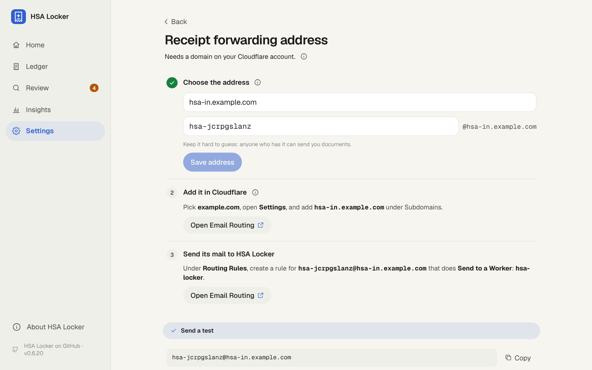

**Daily reminder email** (optional, in Settings): one email on days when something is waiting in Review.

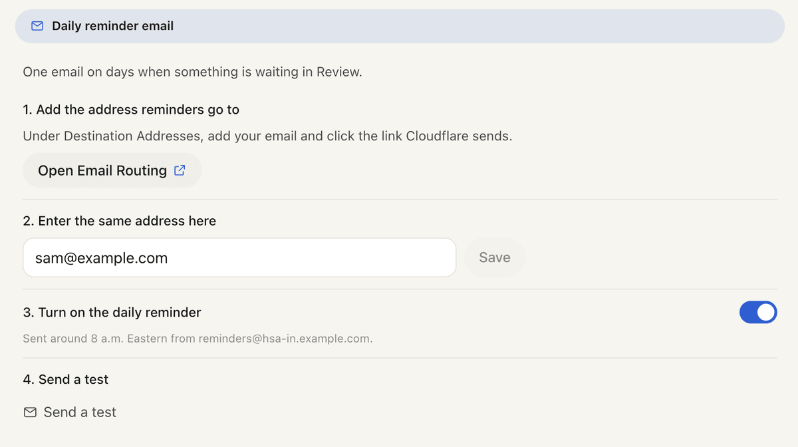

## Choose the AI model

By default documents are read with Workers AI inside your Cloudflare account; nothing to set up. To use your own Anthropic, OpenAI or Gemini key instead, add Worker secrets in the Cloudflare dashboard (**Workers & Pages → hsa-locker → Settings → Variables and Secrets**):

| Secret         | Value                                   |
| -------------- | --------------------------------------- |
| `LLM_PROVIDER` | `anthropic`, `openai` or `gemini`       |
| `LLM_API_KEY`  | your API key                            |
| `LLM_MODEL`    | optional, to override the default model |

With your own key, documents (which contain health information) are sent to that company. Keys live only in Worker secrets and can’t be seen or changed from the app. **Settings → Reading documents → Test extraction** checks the setup. Optional: set `AI_GATEWAY_ID` to route Workers AI calls through an [AI Gateway](https://developers.cloudflare.com/ai-gateway/).

Scanned PDFs (no text layer) can’t be read by Workers AI; they go to Review so you can type them in or upload photos of the pages. Anthropic, OpenAI and Gemini keys read scanned PDFs directly.

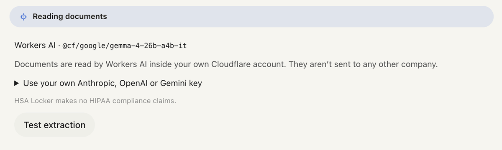

## Use it on your phone

Open your HSA Locker link on the phone, then:

- **iPhone:** in Safari, tap Share, then **Add to Home Screen**.
- **Android:** in Chrome, open the menu and tap **Install app**.

Upload has a **Take photo** button for paper receipts.

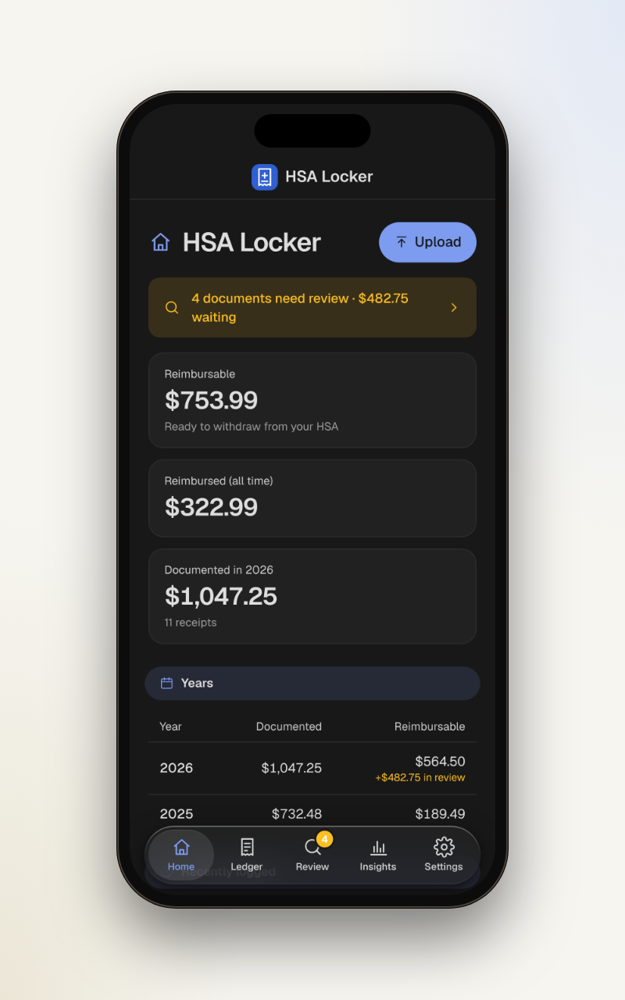

In the installed app, **Settings → Notifications** picks what this phone is told about, including a **Reimbursable milestone** when what you can reimburse reaches an amount you choose.

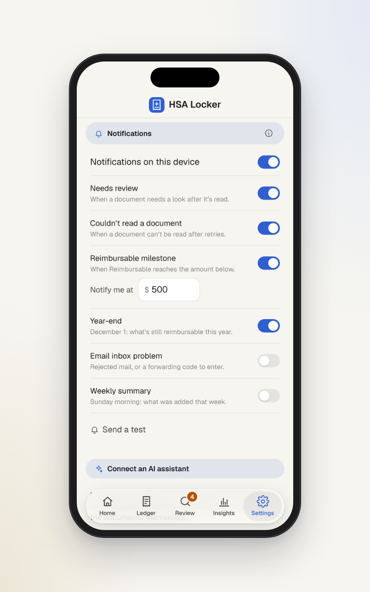

## Connect an AI assistant

HSA Locker includes an [MCP](https://modelcontextprotocol.io) server at `https://<your-hsa-locker>/mcp`. Open **Settings → Connect an AI assistant** to copy your URL and see steps for Claude, ChatGPT, Claude Code and others. When an assistant connects, HSA Locker shows a sign-in page; enter your household password to approve it. Assistants can read your ledger and totals and record reimbursements; they can’t open the documents. Changing the password doesn’t disconnect them; use **Disconnect all** in the same place.

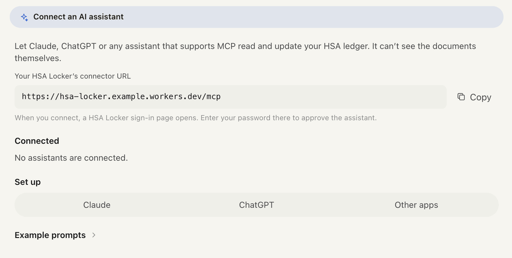

Not sure what to ask? Ask the assistant “what can you do with HSA Locker?”: it calls `get_started`, which returns your current totals and open items with example requests that fit. Some to try:

- “How much can I reimburse myself from my HSA right now, and which receipts make that up?”
- “I withdrew \<amount> from my HSA on \<date>. Find reimbursable receipts that add up to it and record the reimbursement once I confirm.”
- “Go through my review queue: tell me what’s wrong with each item and what you’d fix.”
- “What did we spend on \<person>’s care in \<year>, by category and provider?”

Settings → Connect an AI assistant lists more under **Try asking** (tap one to copy it). The server also offers ready-made prompts, which Claude shows in its **+** menu: **Record a reimbursement**, **Work through Review**, **Year in review** and **Check HSA card receipts**. Each one shows you the list and the total and asks before changing anything. The examples live in `src/shared/examples.ts`; the server instructions, `get_started` and the Settings list all read from it.

## Back up and restore

**Settings → Backup:**

- **Download data backup (JSON)**: every record (people, providers, documents’ details, entries, reimbursements). Not the files.
- **Download all documents (ZIP)**: every original file plus `ledger.csv`. Built in your browser, one file at a time.
- **Restore data from backup** replaces everything with a backup’s contents. On a new deployment, restore the JSON first, then **Restore documents from ZIP** to put the files back.

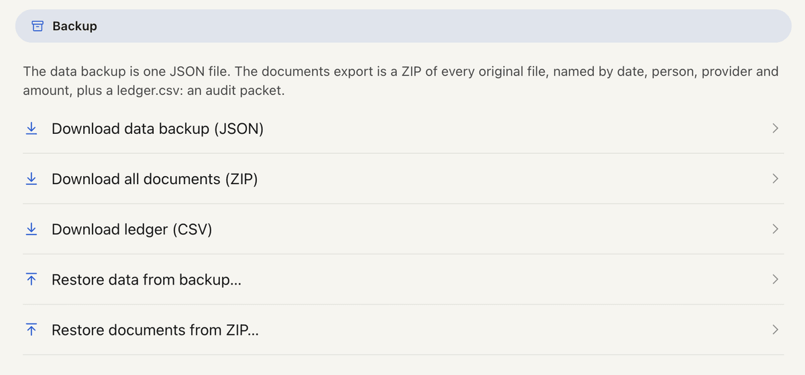

## Coming from HSA Wizard (Google Sheets)

`npm run import:hsa-wizard` imports the old sheet and its Drive folder, collapsing duplicate rows and name variants. See [docs/importing-from-hsa-wizard.md](docs/importing-from-hsa-wizard.md).

## Deploy by hand

If you’d rather not use the button, or want to work on the code:

```sh
git clone https://github.com/tyler-class/HSA-Locker.git && cd HSA-Locker
npm install
npx wrangler login
npx wrangler secret put APP_PASSWORD
npm run deploy
```

`npm run deploy` builds the app, applies migrations to the remote database and deploys the Worker. Wrangler creates the D1 database, R2 bucket and KV namespace on the first deploy.

How the button, Workers Builds and the update workflow fit together: [docs/deploy-and-updates.md](docs/deploy-and-updates.md).

## Local development

```sh
npm install
cp .dev.vars.example .dev.vars    # then set APP_PASSWORD
npm run db:migrate:local
npm run db:seed:sample:local      # optional: a made-up household
npm run dev
```

Workers AI has no local simulator: in `npm run dev` the `AI` binding calls Cloudflare (you’ll be asked to sign in with Wrangler) and may use your Workers AI allowance.

| Script                       | What it does                                       |
| ---------------------------- | -------------------------------------------------- |
| `npm run dev`                | Vite dev server with the Worker running in workerd |
| `npm run build` / `preview`  | Production build / serve the build locally         |
| `npm test`                   | Unit tests and Workers-runtime API tests (Vitest)  |
| `npm run typecheck` / `lint` | TypeScript, ESLint and Prettier                    |
| `npm run deploy`             | Build, migrate the remote database, deploy         |
| `npm run db:migrate:local`   | Apply migrations to the local database             |
| `npm run db:migrate:remote`  | Apply migrations to the deployed database          |
| `npm run sample:build`       | Regenerate `seed/sample.json`                      |
| `npm run import:hsa-wizard`  | Import an HSA Wizard sheet                         |

Tests never call a real model: they use a fake provider and synthetic documents. No real health information belongs in this repo.

### How it’s built

- **Cloudflare Workers** with static assets. **Hono** serves the API under `/api`; **D1** stores records; **R2** stores original files; **Workers AI** reads documents. SQL migrations live in `migrations/`.
- **D1 is the work queue.** Uploads and email insert a `pending` document and start reading it right away; a cron sweeper every 10 minutes retries failures with backoff and picks up anything stuck. The `email()` handler only stores the raw message; parsing happens afterwards, which keeps it within CPU limits.
- **Reading:** PDF text layers come from `toMarkdown()`; photos go to a vision model (`@cf/google/gemma-4-26b-a4b-it`) with a JSON schema. The model’s output is validated, then checked: amounts must appear in the document’s text, names are matched to people and aliases, duplicates are flagged.
- **React**, **TypeScript**, **Vite**, **Tailwind CSS**, **TanStack Query** and **React Router**, with a service worker from `vite-plugin-pwa`.
- `src/shared` holds the money rules (reimbursable, reimbursed, not claimable, pending review), name matching, duplicate detection and the extraction schema, used by both the Worker and the app and covered by unit tests.
- Sign-in uses one password per instance: a signed, HttpOnly session cookie, rate-limited attempts, and sessions that end when the password changes. AI assistants connect over MCP with OAuth 2.1 (`@cloudflare/workers-oauth-provider`).

## Support

HSA Locker is free and built by [Tyler Class](https://tylerclass.net). If you want to say thank you, coffee is my love language: [ko-fi.com/tylerclass](https://ko-fi.com/tylerclass) ☕

## License

[MIT](LICENSE)
